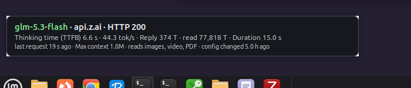
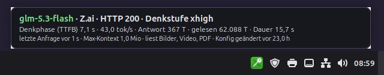
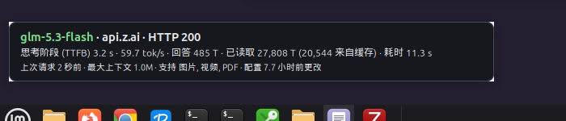

# LLM Monitor for Qwen Code

**A tiny desktop badge that shows what your AI coding agent is *actually* doing — which model really answered, through which provider, how fast, and at what token cost.**

`llm-monitor-for-qwen-code` is a single-file Python desktop widget for [Qwen Code](https://github.com/QwenLM/qwen-code). It sits in a corner of your screen and shows, in real time, what happens between your agent and the language model — the thinking time before the first word appears, the speed of the answer, how many tokens the model read and wrote, and which provider endpoint was actually contacted.



## What you see

| Line | Meaning |
|------|---------|
| `glm-5.3-flash · Z.ai · HTTP 200 · effort max` or `glm-5.3-flash · OpenRouter · inference.net · HTTP 200 · effort high` | The model that **actually answered**, the source that **really produced it** (read from the network request, not from a configuration file), the HTTP status, and the reasoning effort **actually sent on the wire** (may differ from the configuration, e.g. `xhigh` vs `max`) |
| `Thinking time (TTFB) 6.6 s · 44.1 tok/s · Reply 374 T · read 77,818 T · Duration 15.0 s` | Waiting time before the answer started ("thinking"), output speed, size of the answer, how much context the model read, total duration |
| `last request 19 s ago · Max context 1.0M · reads images, video, PDF · config changed 5.0 h ago` | Age of the last measurement, the model's context window, supported input types, and when your Qwen Code configuration was last changed |

A token ("T") is the unit language models count text in — roughly ¾ of a word.

**Behind a local proxy:** if your route runs through a local LLM proxy, the network URL only shows the proxy address (`127.0.0.1`) — meaningless to a human. In that case the monitor resolves the real upstream via the proxy's status API and displays it: Z.ai directly, OpenRouter with the provider that actually served the request, or the proxy's emergency Z.ai fallback.

German interface:



Chinese interface:



## Why

Qwen Code can send OpenTelemetry telemetry about every model request — but the feature is barely documented, and there was no simple way to see it. [Issue #14466](https://github.com/QwenLM/qwen-code/issues/14466) documents the journey: the `otlpProtocol: "http"` setting silently produces **OTLP/JSON** (chunked, `application/json`) — not protobuf, as one would assume — and no stock receiver displays it out of the box.

This monitor fills the gap: it embeds a tiny OTLP/HTTP receiver (JSON and protobuf), understands Qwen Code's exact output, and turns it into a glanceable desktop badge. Nothing leaves your machine — the receiver only listens on `127.0.0.1`.

## How it works

- **Line 1–2 (real traffic):** Qwen Code sends one OpenTelemetry span per model request to the embedded receiver. The LLM span carries the model that answered (`gen_ai.response.model`), the reasoning effort actually sent (`gen_ai.request.reasoning.level`), and the usage metrics; a separate HTTP span carries the real request URL (`url.full`) and the HTTP status code. The monitor accepts only HTTP spans that are a direct child of a model-request span (matched via parent span ID) — unrelated HTTP traffic from the same process (web fetches, update checks) never displaces the route display. The monitor shows exactly that — **what came back, not what the configuration claims**.
- **Many sessions, one badge:** every running Qwen Code session streams its spans to the same embedded receiver, and the monitor keeps only a single record — the badge always shows the most recently completed model request across all sessions ("last wins"). The figures in line 2 (thinking time, throughput, tokens, duration) belong to that one request; they are never summed or averaged across sessions. How stale the display is can be read from the "last request X ago" age in line 3.
- **Proxy-aware source resolution:** when the request URL points at a loopback address, the URL says nothing about the real source. The monitor then polls the local LLM proxy's status endpoint for the leg that actually served the last request — Z.ai directly or OpenRouter, including the OpenRouter provider name and the reasoning effort the proxy actually sent — and shows that in line 1 instead of the raw loopback address.
- **Line 3 (configuration):** the widget polls `~/.qwen/settings.json` and shows the model's context window and supported input types, plus the age of the last configuration change.
- `otlpProtocol: "http"` also works with a standard OpenTelemetry collector; stock collectors accept both JSON and protobuf.

## Requirements

- Linux with X11, GTK 3, and Python 3 with GObject introspection (stock packages on Linux Mint / Ubuntu / Debian)
- [Qwen Code](https://github.com/QwenLM/qwen-code) — 0.26.0 or newer for the reasoning-effort display (telemetry added in [0.26.0](https://github.com/QwenLM/qwen-code/pull/14718); older versions work, but the effort stays hidden)

## Installation

1. Enable telemetry in `~/.qwen/settings.json`:

```json
"telemetry": {
  "enabled": true,
  "otlpEndpoint": "http://127.0.0.1:4318",
  "otlpProtocol": "http"
}
```

2. Run the monitor, then start a **new** Qwen Code session (only sessions started after enabling telemetry send spans):

```bash
python3 qwen-llm-monitor.py
```

3. For automatic startup, place a `.desktop` file in `~/.config/autostart/`:

```ini
[Desktop Entry]
Type=Application
Name=LLM Monitor for Qwen Code
Exec=python3 /path/to/qwen-llm-monitor.py
X-GNOME-Autostart-enabled=true
```

## Configuration

| Environment variable | Default | Meaning |
|----------------------|---------|---------|
| `QWEN_MONITOR_SETTINGS` | `~/.qwen/settings.json` | Path to the Qwen Code settings file |
| `QWEN_MONITOR_OTLP_PORT` | `4318` | Port of the embedded OTLP receiver |
| `QWEN_MONITOR_WIDTH` | `600` | Badge width in pixels |
| `QWEN_MONITOR_PROXY_STATUS` | `http://127.0.0.1:8787/status` | Status URL of the local LLM proxy used to resolve the real source behind loopback routes |

The badge can be dragged with the left mouse button (position is remembered), right-click quits it. Only one instance can run at a time.

## Languages

The interface follows your desktop language: **German**, **English** (default), and **Chinese**. Decimal separators switch accordingly (German comma, otherwise point).

## Known limitations

- Linux/X11 with GTK 3 only.
- Sessions must be started *after* enabling telemetry — already-running sessions do not send spans.
- One badge, no per-session view: the monitor reads no session identifier from the spans, so requests cannot be attributed to a specific Qwen Code session, and throughput is never summed across concurrently running sessions — the display always shows the single most recently completed request ("last wins").
- Throughput values above 300 tok/s are treated as reporting glitches of the exporter and hidden.
- On Z.ai-direct routes the effort comes from Qwen Code telemetry (`gen_ai.request.reasoning.level`), which mirrors the flat `reasoning_effort` request property only — nested `reasoning.effort` objects are not mapped upstream. Routes through the local LLM proxy therefore read the effort from the proxy's status tap (what the proxy actually forwarded to the upstream); OpenRouter-direct routes (nested, no proxy tap) show no effort.
- The effort reflects the *first* request of a session — a later `/effort` change is picked up only in a new session (upstream first-request snapshot).
- **`max` may arrive as `xhigh` (hostname-gated effort clamp):** Qwen Code clamps a configured `reasoningEffort: max` down to `xhigh` whenever the route's hostname is not a Z.ai host — even if the actual upstream (e.g. a local proxy forwarding to Z.ai) fully supports `max` ([Issue #15235](https://github.com/QwenLM/qwen-code/issues/15235)). The badge shows the effort really sent, so the clamp is visible on the wire. Confirmed workaround: add `"extra_body": {"reasoning": {"effort": "max"}}` to the provider entry — `extra_body` merges *after* the clamp and restores the explicit value. Note that `model.samplingParams.reasoning` does **not** work for this: it skips the clamp but is never written to the request body.

## Status and maintenance

The monitor has been in daily production use since October 2026 as the telemetry display of a working AI workstation. It is developed and maintained by [Michael Logies](https://github.com/Michael-Logies) in close collaboration with AI coding agents — this README was drafted with the help of Qwen Code. Provided **as-is**: bug reports are welcome and handled on a best-effort basis, but there is no formal support.

## The bigger picture

This monitor is part of a reproducible **AI workstation for students** — a complete setup guide for research, learning, and literature work on a Linux machine:

- **[AI Workstation for Students: Research, Learning, and More](https://www.logies.de/ai-workstation-linux-vm.html)** (English)
- **[KI-Arbeitsplatz fürs Studium: Recherche, Lernen und mehr](https://www.logies.de/studienarbeitsplatz-linux-vm.html)** (German)

A sibling project from the same setup is [Semantic Memory MCP](https://github.com/Michael-Logies/semantic-memory-mcp) — persistent, searchable memory for AI coding agents.

## License

AGPL-3.0 — see [LICENSE](LICENSE).
